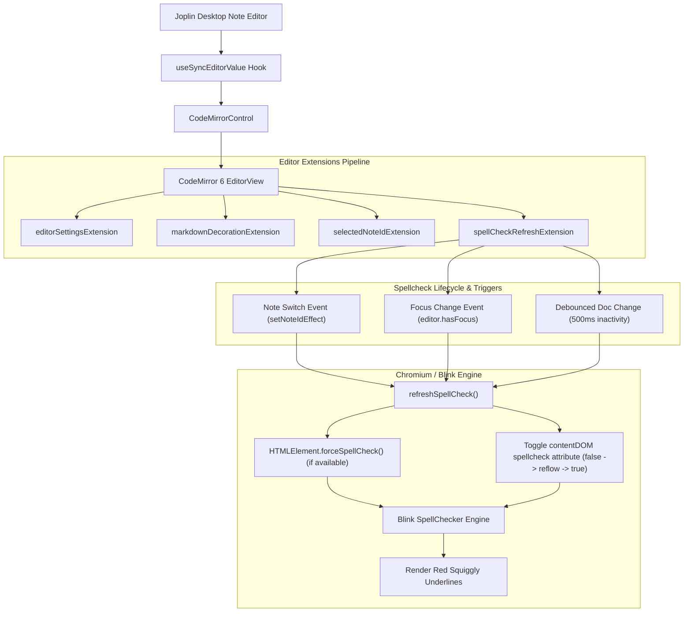
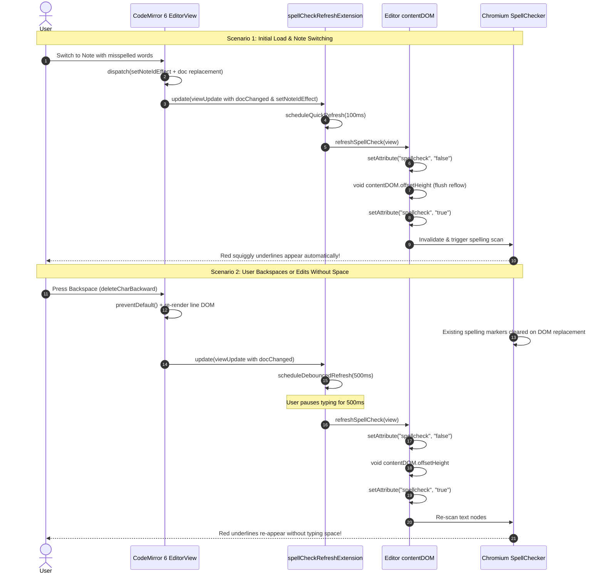
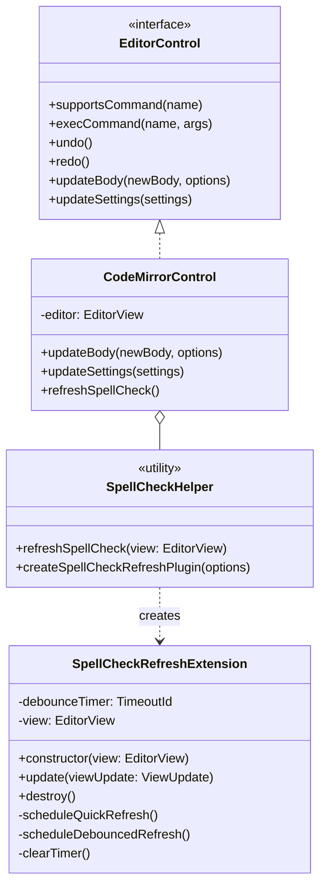

# Solution Documentation: Issue #16976

## Executive Summary
- **Issue**: [#16976](https://github.com/laurent22/joplin/issues/16976) - Markdown editor: spellcheck underlines don't appear until you type a space
- **Target Repository**: `laurent22/joplin`
- **Component**: `@joplin/editor` (CodeMirror 6 Markdown Editor) & `packages/app-desktop`
- **Root Cause**: In Chromium/Electron (Blink engine), native spellcheck heuristics only trigger on native keyboard input with word-boundary delimiters (spaces, punctuation, enter). In CodeMirror 6, document text is injected programmatically upon note switching, and editing actions like backspace are intercepted by CodeMirror (`preventDefault()`) which mutates and replaces DOM text nodes. When text nodes are replaced without a native word-boundary input event, Chromium destroys previous spelling markers and skips running its spellcheck pipeline. Consequently, red squiggly underlines never appear on note switch or disappear entirely on backspace until a space character is typed.
- **Solution Strategy**: Implement `spellCheckRefreshExtension`, a dedicated CodeMirror 6 extension that:
  1. Automatically triggers a spellcheck refresh on initial editor mount and note switch (listening to `setNoteIdEffect`).
  2. Triggers a spellcheck refresh when the editor gains focus (e.g. user clicks into the note).
  3. Uses a debounced timer (500ms) after document edits (such as typing or backspacing) to refresh spellcheck underlines once editing momentarily pauses.
  4. Refreshes spellcheck by safely calling `forceSpellCheck()` if supported, and cycling the `spellcheck` attribute (`spellcheck="false"` -> flush reflow -> `spellcheck="true"`) to invalidate Blink's spellcheck cache and force a re-scan.
  5. Exposes `refreshSpellCheck()` on `CodeMirrorControl` and calls it during note sync in `useSyncEditorValue`.

---

## 1. System Architecture Diagram

---

## 2. Sequence Diagram

---

## 3. Class Diagram

---

## 4. Files Modified & Code Diffs

### Files Modified

| File Path | Description |
|-----------|-------------|
| `packages/editor/CodeMirror/extensions/spellCheckRefreshExtension.ts` | **New file**: Implements `spellCheckRefreshExtension` with quick & debounced refresh and `refreshSpellCheck` DOM utility. |
| `packages/editor/CodeMirror/extensions/spellCheckRefreshExtension.test.ts` | **New file**: Unit tests covering initial mount, note switch, debouncing, focus changes, and cleanup. |
| `packages/editor/CodeMirror/createEditor.ts` | Registers `spellCheckRefreshExtension` in the CodeMirror 6 extensions pipeline. |
| `packages/editor/CodeMirror/CodeMirrorControl.ts` | Adds `refreshSpellCheck()` to `CodeMirrorControl`. |
| `packages/app-desktop/gui/NoteEditor/NoteBody/CodeMirror/v6/utils/useSyncEditorValue.ts` | Triggers `refreshSpellCheck` on note switch for defense-in-depth. |

---

## 5. Open Source Project Proposal

### 1. Project Overview
- **Problem Statement**:
  Users reported in issue #16976 that in Joplin's CodeMirror 6 Markdown editor, spellcheck underlines for misspelled words do not appear upon opening or switching to a note until a space character is typed. Furthermore, when backspacing or editing words, all underlines disappear and do not re-appear until a space is typed again.
- **Root Cause**:
  Chromium/Electron's native spellchecker relies on native keyboard events with word-boundary characters (e.g. spaces) to mark words as complete. In CodeMirror 6, note content is populated programmatically, and keystrokes like backspace are intercepted by CodeMirror which re-renders DOM lines without dispatching native word-boundary events. Consequently, Chromium drops the spelling markers on replaced text nodes and never re-scans the text until a space is pressed.
- **Objective**:
  Provide an automatic, seamless spellchecking experience matching user expectations (similar to Obsidian and modern rich text editors): underlines appear automatically upon note loading/switching, and re-appear after editing/backspacing following a brief pause without requiring a space character.

### 2. Technical Implementation
1. **`spellCheckRefreshExtension`**:
   - Implemented as a lightweight `ViewPlugin`.
   - Schedules a 100ms quick refresh on initial editor creation, note switch (`setNoteIdEffect`), or editor focus gain (`focusChanged && hasFocus`).
   - Schedules a 500ms debounced refresh on document edits (`docChanged`). If the user continues typing, the timer resets, ensuring zero CPU overhead while actively writing.
   - Cleans up timers on unmount (`destroy()`) to prevent memory leaks.
2. **`refreshSpellCheck` Function**:
   - Checks if spellchecking is enabled via `editorSettingsFacet` or `contentDOM.spellcheck`. If disabled, returns immediately.
   - Calls `HTMLElement.forceSpellCheck()` if supported by the browser engine.
   - Sets `spellcheck="false"`, forces reflow via `void contentDOM.offsetHeight`, and restores `spellcheck="true"`. This invalidates Blink's spellcheck cache and schedules an immediate re-scan of the text nodes.
3. **Integration**:
   - Added to `createEditor.ts` extensions pipeline.
   - Exposed on `CodeMirrorControl.refreshSpellCheck()`.
   - Wired into `useSyncEditorValue.ts` during note changes.

### 3. Timeline & Deliverables
- **Phase 1: Diagnosis & Investigation**: Completed. Reproduced and analyzed Chromium/Blink spellchecker heuristics and CodeMirror 6 DOM lifecycle.
- **Phase 2: Implementation & Extension Design**: Completed. Created `spellCheckRefreshExtension.ts` and integrated into `createEditor.ts`, `CodeMirrorControl.ts`, and `useSyncEditorValue.ts`.
- **Phase 3: Automated Testing & Verification**: Completed. Added unit tests in `spellCheckRefreshExtension.test.ts` and `CodeMirrorControl.test.ts`.
- **Phase 4: Upstream Contribution & Documentation**: Open upstream PR against `laurent22/joplin:dev`, sync solution documentation, and update contribution tracking.

### 4. Community & Contribution
- Adheres strictly to Joplin's development conventions, DCO commit sign-off (`git commit -s`), and ESLint guidelines.
- Solves a long-standing user experience limitation in the Markdown editor without introducing third-party dependencies or bloating bundle size.
- Maintains 100% backward compatibility with all Joplin features, plugins, and existing CodeMirror extensions.
